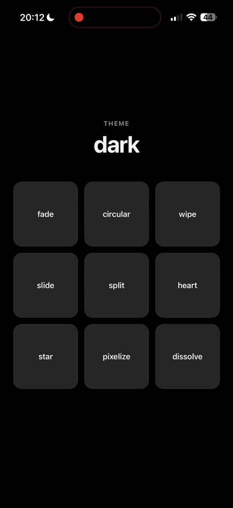

<h1 align="center">React Native Theme Transition</h1>

<p align="center">
  Nine animated theme transitions for React Native. Skia-powered, runs in Expo Go.
</p>

<p align="center">
  <a href="https://www.npmjs.com/package/react-native-theme-transition"></a>
  <a href="https://bundlephobia.com/package/react-native-theme-transition"></a>
  
  
  <a href="https://github.com/marioprieta/react-native-theme-transition/blob/main/LICENSE"></a>
</p>

<p align="center">
  
</p>

## Features

- **Nine transition styles.** `fade`, `circularReveal`, `heart`, `star`, `wipe`, `slide`, `split`, `pixelize`, `dissolve`.
- **Expo Go ready.** Uses Skia and Reanimated without a package-specific native module. Current device checks use native Debug builds on Expo SDK 58 / React Native 0.88.1; earlier checks used Expo Go. See the compatibility notes below.
- **Full TypeScript inference.** `useTheme()` and `setTheme()` know your theme names and color tokens without manual generics.
- **System theme built in.** Follows OS appearance with zero-flash startup.
- **Runtime checks.** Configuration and numeric options are validated with descriptive errors; per-call variant names remain primarily TypeScript-checked.
- **React Compiler compatible.** All hooks follow the [Rules of React](https://react.dev/reference/rules).

## Requirements

- React **19.0.0+** and React Native **0.78.0+**
- `@shopify/react-native-skia` **2.0.0+**
- `react-native-reanimated` **4.0.0+**
- `react-native-worklets` **0.5.0+**

## Try it

- [Demo app](https://github.com/marioprieta/theme-demo) Primary demo: an Expo SDK 58 app running `react-native-theme-transition` 2.0.2 on iOS and Android.
- [Snack](https://snack.expo.dev/@mariops03/react-native-theme-transition) Separate public playground. It currently supports Expo SDK 55 at most, so check its dependency versions before comparing it with the SDK 58 validation baseline. The web preview is unsupported because the Skia `RuntimeEffect` overlays are native-only.
- [Docs](https://react-native-theme-transition.vercel.app) API reference, recipes, migration guide.

Using `expo-glass-effect`? Pass `colorScheme={theme.scheme}` to `GlassView` to keep its material color aligned during a fade. See the [Liquid Glass recipe](https://react-native-theme-transition.vercel.app/docs/recipes/glass-effect) for a reusable app component and the verified scope.

The declared peer ranges describe package requirements, not a tested device matrix.
Runtime checks currently cover Expo SDK 58.0.25 with React 19.3.0, React Native
0.88.1, Skia 2.14.0, Reanimated 4.7.1 and Worklets 0.13.0, using native Debug
builds of the demo app on an iOS 26.5 simulator and an Android API 37 emulator;
each platform ran all nine transitions light→dark and dark→light (18/18). Earlier
checks used Expo Go 58.0.3 with React Native 0.88.0, and the detailed liquid-glass
fade measurements come from that prior Expo Go comparison rather than the current
native integration. The Skia 2.4.18, 2.6.2 and 2.14.0 CI matrix is configured for
type-check and build only. These are simulator/emulator results: no physical-device,
120 Hz, or universal flash-free guarantee is claimed. Older combinations within the
peer ranges need separate validation.

## Installation

```bash
# Expo (install the versions matched to your SDK)
npx expo install react-native-theme-transition @shopify/react-native-skia react-native-reanimated react-native-worklets

# React Native CLI
npm install react-native-theme-transition @shopify/react-native-skia react-native-reanimated react-native-worklets
```

The documented Expo setup needs no additional Babel plugin: `babel-preset-expo` configures the worklets plugin automatically. Bare React Native CLI projects must add `react-native-worklets/plugin` as the **last plugin** in `babel.config.js` (do not add `react-native-reanimated/plugin` — the worklets plugin replaces it).

> Using Claude Code, Cursor, or Codex? Install the [AI-assisted setup](#ai-assisted-setup) skill first and the agent can run the installation from the v2 API reference.

## Quick Start

```ts
// theme.ts
import { createThemeTransition } from 'react-native-theme-transition'

export const { ThemeTransitionProvider, useTheme } = createThemeTransition({
  themes: {
    light: { background: '#ffffff', text: '#000000', primary: '#007AFF' },
    dark:  { background: '#000000', text: '#ffffff', primary: '#0A84FF' },
  },
})
```

```tsx
// App.tsx
import { ThemeTransitionProvider } from './theme'

export default function App() {
  return (
    <ThemeTransitionProvider initialTheme="system">
      <MyApp />
    </ThemeTransitionProvider>
  )
}
```

```tsx
// MyScreen.tsx
import { Pressable, Text, View } from 'react-native'
import { useTheme } from './theme'

function MyScreen() {
  const { theme, setTheme, isTransitioning } = useTheme()

  return (
    <View style={{ flex: 1, backgroundColor: theme.colors.background }}>
      <Text style={{ color: theme.colors.text }}>Current: {theme.name}</Text>
      <Pressable
        onPress={() => setTheme(theme.name === 'dark' ? 'light' : 'dark', { transition: 'circularReveal' })}
        disabled={isTransitioning}
      >
        <Text style={{ color: theme.colors.primary }}>Toggle</Text>
      </Pressable>
    </View>
  )
}
```

`useTheme()` returns `theme`, `preference`, `setTheme`, and `isTransitioning`. See the [useTheme reference](https://react-native-theme-transition.vercel.app/docs/api/use-theme) for the full API.

> Want the agent to write all three files? With the [AI-assisted setup](#ai-assisted-setup) skill installed, Claude Code or Cursor has these steps as a recipe and applies them to your project directly.

## AI-assisted setup

For agentic coding with Claude Code, Cursor, or Codex, the library ships a skill:

```bash
npx skills add https://skills.sh/marioprieta/skills/react-native-theme-transition
```

It's the same content as the docs site, split into files so the agent can pull the relevant one (api, guides, recipes, examples) instead of loading everything.

## Contributing

Contributions are welcome. Please read the [contributing guide](./CONTRIBUTING.md) and open an issue first to discuss what you'd like to change.

## License

MIT
