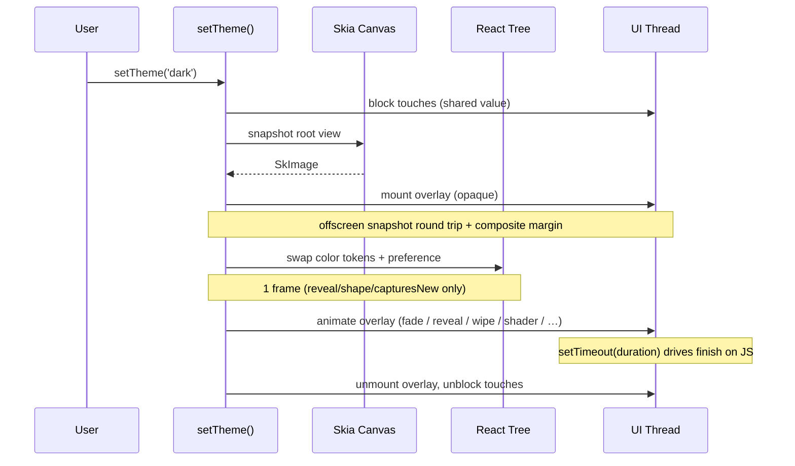

Every transition uses the same trick. Take a picture of what's on
screen, put it on top, change the colors underneath, then animate
the picture away. The picture is a Skia `SkImage`. The animation
runs on the UI thread via Reanimated. The library adds no explicit Reduce Motion check; `withTiming`
inherits Reanimated's system default.

## The Two-Commit Flow



## Step by Step

1. `setTheme('dark')` runs. Touches are blocked immediately through
   a Reanimated shared value, with no re-render and no JS round-trip.
2. The root view is snapshotted into a Skia `SkImage` via Skia's
   `makeImageFromView`. For a manual theme swap, the preference is
   stashed in a ref instead of updating context before capture.
   System-mode changes can still enqueue React state, and consumer
   callbacks can enqueue their own updates; there is no pre-capture wait.
3. The snapshot is mounted as an opaque overlay covering the entire
   provider.
4. The engine spends a Skia paint round trip on the mounted snapshot
   before the colors swap: one frame (`SETTLE.overlayCommit`) for the
   snapshot to reach the native Canvas, `syncOverlayPaint`
   (`makeImageSnapshotAsync` re-renders the picture offscreen and
   reads it back), then `SETTLE.skiaPaintSynced` for the composite. If
   that probe is unavailable the engine falls back to the
   `SETTLE.skiaPaint` frame budget, which alone can flash the new
   theme through during the inner-tree color swap on Android.
5. Color tokens swap underneath, and the stashed pick lands in
   `preference` in the same commit. The provider updates its
   context, every consumer re-renders with the new theme. Invisible,
   because the overlay is still fully opaque on top.
6. **One frame** for the tree to commit and repaint
   (`SETTLE.treeRepaint`). Only for reveal-style and shape
   transitions that expose the inner tree through a growing hole,
   plus slide and pixelize that capture a second snapshot. Fade,
   wipe, split, and dissolve skip this wait because the overlay
   covers everything until the animation resolves.
7. The overlay animates: fade, expanding shape, wipe, slide, split,
   pixelize, or dissolve. Every variant runs entirely on the UI
   thread via Reanimated worklets.
8. A `setTimeout` matched to the animation duration fires the
   finish handler on the JS thread, which unmounts the overlay and
   unblocks touches.

## The Settle Pattern

A few short waits, each doing exactly one job.

| Wait | Frames | Why |
|---|---|---|
| `SETTLE.overlayCommit` | 1 | Let the mounted snapshot reach the native Canvas before probing its paint. |
| `SETTLE.skiaPaintSynced` | 1 | Allow compositing after the offscreen snapshot round trip; this is not a presentation callback. |
| `SETTLE.skiaPaint` | 2/3 | Fallback budget when the paint probe is unavailable. |
| `SETTLE.treeRepaint` | 1 | Let Android repaint deep ScrollView children before a reveal or shape animation exposes them. |

The values are tuned empirically and exercised on iOS Simulator and
Android Emulator. The probe renders the current Canvas picture offscreen;
it neither acknowledges a particular React commit nor confirms display
presentation. Zero detected flashes at roughly 24–30 fps do not exclude
single-frame defects at 60 or 120 Hz. Physical-device validation is still needed. `SETTLE.treeRepaint` is gated to the kinds of transitions
that actually need it, so fade and wipe save one frame of latency.

## Why Snapshots?

Most theme-transition libraries use a custom native module to
manipulate the view hierarchy directly. The snapshot approach runs
entirely on Skia and Reanimated, both bundled in modern Expo SDKs,
so it works in Expo Go without a prebuild.

The trade-off is that the overlay is a still image. Any live
content behind it (a video, a Lottie animation, a camera preview, a
ticking counter) is frozen for the transition's duration. That's
typically a few hundred milliseconds; nobody notices in practice.

## Reduce Motion

The engine passes `duration` and `easing` to `withTiming` without setting
`reduceMotion`. Reanimated therefore uses its default, `ReduceMotion.System`.
An animation may finish immediately while the library's independent JS
cleanup timer still waits for the configured duration.

To skip capture, overlay setup and the cleanup delay when the system requests
reduced motion, read the setting in the app and use `animated: false`:

```tsx
import { AccessibilityInfo } from 'react-native'

const reduced = await AccessibilityInfo.isReduceMotionEnabled()
setTheme('dark', reduced ? { animated: false } : undefined)
```

## See Also

- [setTheme reference](/docs/api/use-theme#settheme). Every option, every variant.
- [Callbacks](/docs/guides/callbacks). When each callback fires and why.
- [Troubleshooting](/docs/guides/troubleshooting). Common gotchas.
